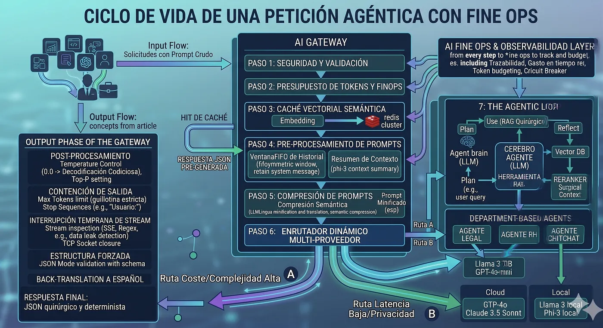

# Estrategias de Arquitectura para minimizar tu factura IA 💸

> Por **Psagarna** · Apr 16, 2026 · 24 min de lectura
> Tags: `AI` · `AI Gateway` · `AI Governance` · `LLM` · `LLM Tokens`

## Índice

1. [¿Cómo reducir los datos de entrada en modelos LLM?](#cómo-reducir-los-datos-de-entrada-en-modelos-llm)
   - [Prompt Caching](#prompt-caching)
   - [Gestión histórica de los prompts](#gestión-histórica-de-los-prompts)
   - [Resumir el Contexto](#resumir-el-contexto)
   - [Compresión de Prompts](#compresión-de-prompts)
   - [RAG y Fragmentación Semántica](#rag-y-fragmentación-semántica)
   - [Caché Semántico](#caché-semántico)
   - [Enrutador Semántico](#enrutador-semántico)
2. [¿Cómo reducir los datos de salida en modelos LLM?](#cómo-reducir-los-datos-de-salida-en-modelos-llm)
   - [Control del lenguaje coloquial](#control-del-lenguaje-coloquial)
   - [Forzar Salidas Estructuradas (JSON Mode)](#forzar-salidas-estructuradas-json-mode)
   - [Freno de Mano Semántico](#freno-de-mano-semántico)
   - [Interrupción temprana](#interrupción-temprana)
   - [Estabilizar la respuesta](#estabilizar-la-respuesta)
3. [Conclusión](#conclusión)
4. [Referencias](#referencias)

---

En la era de la inteligencia artificial generativa, los tokens se han convertido en la nueva unidad de costo. Cada palabra que se envía — y cada coma que el modelo devuelve — impacta directamente en tu factura y en la latencia de tu sistema. Para ponerlo en perspectiva: cada palabra que envías o recibís del modelo equivale a entre 1 y 2 tokens, ¡y hasta los emojis cuentan! Si estás construyendo aplicaciones escalables sin una estrategia de control, no estás diseñando una arquitectura: estás creando una bomba de tiempo financiera.

Detrás de cada llamada a modelos como Claude, OpenAI, Gemini o Mistral hay una realidad incómoda: empezar es trivial, escalar no lo es. Lo que comienza con unos pocos usuarios puede crecer rápidamente a decenas de miles, y cuando la factura llega a fin de mes, el problema ya no es técnico, es económico.

Bienvenidos a la disciplina del **AI FinOps**. En este artículo exploraré estrategias de arquitectura organizadas según el ciclo de consumo de tokens: por un lado, el **input** (lo que el usuario envía en un prompt) y, por otro, el **output** (lo que el modelo genera como respuesta).

El objetivo es claro: maximizar la eficiencia financiera en el uso de LLMs, sin afectar a la calidad ni a la solidez de su razonamiento.

## ¿Cómo reducir los datos de entrada en modelos LLM?

La optimización del consumo de tokens comienza en la capa de entrada. Antes de invocar cualquier modelo, es fundamental introducir un **AI Gateway** que actúe como punto único de control sobre todas las solicitudes hacia los LLMs [Figura 1].

Este gateway permite desacoplar la lógica de negocio del proveedor del modelo y aplicar políticas transversales como *prompt shaping*, *token budgeting*, validación de payloads y *rate limiting*. Además, habilita estrategias de **routing dinámico**, seleccionando en tiempo de ejecución el modelo más adecuado en función de la latencia, el coste o la complejidad de la tarea (por ejemplo, derivar tareas simples a modelos locales y tareas complejas al cloud).

Desde una perspectiva de "AI FinOps", esta capa es crítica porque introduce **observabilidad a nivel de tokens**: métricas por usuario, servicio o agente, trazabilidad de prompts y control del consumo en tiempo real. Sin este nivel de instrumentación, el crecimiento del input es opaco y sumamente difícil de optimizar.

En sistemas a escala, el problema no es solo cuánto "input" envías, sino **cómo, cuándo y a qué modelo**. El AI Gateway convierte estas decisiones en variables configurables y medibles. A continuación, desgloso los mecanismos arquitectónicos clave para llevar a cabo esta orquestación: *Prompt Caching*, Gestión Histórica de Contexto, Resumen Dinámico, Compresión de *Prompts*, RAG con Fragmentación Semántica, Caché Semántico y Enrutamiento Semántico. Dependiendo de la complejidad del caso de uso, será mejor aplicar estas técnicas de forma aislada o componerlas en un *pipeline* integral.



*Figura 1: Generada con Nano Banana*

### Prompt Caching

En teoría de LLMs, cuando envías un texto, el modelo realiza un intenso esfuerzo computacional en la fase de lectura (*pre-fill*) para calcular el estado de atención matemático de esas palabras, conocido como *KV Cache*. El **Prompt Caching** es una técnica que permite al modelo evitar recalcular todo esto desde cero. El servidor, literalmente, guarda ese estado matemático pre-calculado en su memoria "RAM temporal".

En la práctica, proveedores como Anthropic, Google y OpenAI han habilitado esta opción para contextos masivos. En lugar de enviar tu *System Prompt* de 5.000 palabras o un PDF de 50 páginas en cada conversación, lo envías una sola vez indicando que se mantenga en caché. Sigues llamando al LLM y pagando por la respuesta que genera, pero el costo de lectura de ese documento pre-cargado se desploma drásticamente.

🛠️ **Detalle técnico:** En la API de Anthropic, por ejemplo, basta con añadir `cache_control: {"type": "ephemeral"}` al bloque de contenido. Las peticiones siguientes que referencien este bloque te costarán hasta un **90% menos en tokens de entrada**. Como beneficio adicional, el *Time-To-First-Token* (TTFT) bajará de varios segundos a apenas unos milisegundos, mejorando radicalmente la latencia que percibe el usuario final.

💡 **Ejemplo práctico:** Imaginá un agente de soporte nivel 2 que asiste a tus programadores. Como contexto base, necesita conocer la documentación técnica completa de tu API interna (un bloque masivo de 80.000 *tokens*).

- **Sin *Caching*:** Si un desarrollador hace 10 preguntas en una misma sesión de chat, el sistema re-procesará los 80.000 *tokens* de la documentación en cada turno. Terminarás pagando por 800.000 *tokens* de lectura inútil, con una latencia de 15 segundos por respuesta.
- **Con *Caching*:** Tu AI Gateway inyecta la directiva de caché en el primer mensaje de la mañana. Los 80.000 *tokens* se calculan una sola vez. Durante el resto de la jornada, cada vez que cualquier programador haga una pregunta, el modelo recupera el estado de memoria instantáneamente. Tu factura de lectura se reduce un 90% y las respuestas comienzan a fluir en milisegundos.

⚠️ **Trade-off Arquitectónico (Volatilidad y Coste de Inserción):** Mantener matrices matemáticas en la VRAM de las GPUs es extremadamente caro para el proveedor, por lo que esta memoria es efímera (en Anthropic, por ejemplo, el caché se purga tras 5 minutos de inactividad). Además, el "coste de escritura" (*cache write*) suele tener un recargo sobre el precio base del *token* para compensar al proveedor. Si tu sistema tiene un tráfico esporádico (ej. un usuario hace una pregunta cada media hora), el caché caducará constantemente. En este escenario, terminarás pagando el sobrecoste de inserción una y otra vez sin llegar a amortizarlo con los descuentos de lectura, empeorando paradójicamente tu balance "AI FinOps".

### Gestión histórica de los prompts

A nivel arquitectónico, las APIs de los LLMs son inherentemente *stateless* (sin estado). El modelo no tiene memoria interna de lo que el usuario le dijo hace un minuto. Para mantener la ilusión de una conversación continua, tu aplicación debe enviar la transcripción completa, desde el mensaje número uno, en cada nueva petición. Esto genera un crecimiento acumulativo y silencioso en el consumo de tokens: en una conversación de 20 "idas y vueltas", terminas pagando una y otra vez por leer mensajes que ya se procesaron en el pasado.

El peor enemigo de la escalabilidad en agentes conversacionales es permitir que este historial crezca sin restricciones. Aquí es donde el Gateway interviene aplicando una **"Ventana Deslizante"**. En lugar de enviar todo el bloque de texto, intercepta la petición en tiempo de vuelo y aplica un recorte selectivo antes de mandarla al proveedor.

🛠️ **Detalle técnico:** Si el payload (el array de `messages` en formato JSON) tiene 30 elementos, el Gateway aplica un algoritmo FIFO (*First-In, First-Out*) asimétrico. Retiene de forma inmutable el primer mensaje (`role: "system"`) para no perder la personalidad del bot ni las reglas de seguridad, pero recorta los pares de usuario/asistente antiguos. Al enviar únicamente los últimos 4 o 5 intercambios, mantienes el contexto inmediato. Para el 95% de las preguntas de seguimiento, el LLM no necesita recordar el "Hola, buenos días" de hace media hora.

💡 **Ejemplo práctico:** Imagina un *chatbot* de soporte técnico donde un usuario está intentando configurar un router.

- **Sin gestión de historial:** Llegan al turno 15 de la conversación y el usuario simplemente escribe: *"¡Listo, ya funciona! Gracias"*. Para que el LLM genere un simple *"De nada"*, tu aplicación acaba de enviarle toda la transcripción previa (los saludos, los errores, los intentos fallidos). Has pagado por procesar 4.000 *tokens* de entrada solo para responder a un agradecimiento. Es un crecimiento cuadrático del gasto.
- **Con gestión (*Ventana Deslizante*):** En ese mismo turno 15, tu AI Gateway intercepta el *array* de mensajes. Conserva la instrucción original (`role: "system"`) y solo los dos últimos mensajes. El modelo recibe un contexto limpio de 100 *tokens* y responde perfectamente. El ahorro acumulado a lo largo de millones de conversaciones es gigantesco.

⚠️ **Trade-off Arquitectónico (Amnesia Contextual):** Un recorte estricto basado puramente en la cantidad de mensajes (FIFO) introduce un problema grave de usabilidad: la amnesia. Si configuras la ventana para guardar solo los últimos 4 mensajes, y en el turno 10 el usuario dice *"Oye, ¿me puedes repetir el primer código de error que me dio el sistema al principio?"*, el bot fallará estrepitosamente o alucinará una respuesta, porque ese dato ya fue decapitado del *payload*. Este riesgo obliga a los arquitectos a no depender únicamente de ventanas deslizantes y a combinarlas con mecanismos de memoria a largo plazo, como la de **Resumir el Contexto** (que veremos a continuación).

### Resumir el Contexto

El truncamiento estricto de la memoria (la estrategia anterior) tiene un efecto secundario peligroso: la "amnesia del modelo". Si simplemente eliminas los mensajes antiguos, el agente olvida decisiones cruciales o datos que el usuario proporcionó al principio de la sesión. Para retener la coherencia conversacional sin pagar el altísimo costo lineal de arrastrar miles de tokens en cada llamada, en lugar de *eliminar* información, debemos *condensarla* semánticamente.

Cuando una conversación prolongada se acerca a tu "presupuesto máximo de tokens" (por ejemplo, 3.000 tokens), la solución AI FinOps es implementar una arquitectura de múltiples niveles (*tiered routing*), donde modelos más baratos asisten a los más caros.

🛠️ **Detalle técnico:** Utilizas un modelo pequeño y ultrarrápido (como `phi-3-mini` o `Llama-3-8B` local) para condensar los mensajes antiguos en un párrafo denso de 100 tokens. El Gateway inyecta ese resumen como una instrucción oculta en el *System Prompt* del nuevo turno: *"Contexto histórico: El usuario se llama Carlos y descartó usar AWS"*. Luego, envías este payload ultra-optimizado al modelo principal (como GPT-4o o Claude 3.5 Sonnet).

💡 **Ejemplo práctico:** Imagina un asistente de preventa técnica donde un cliente (Carlos) lleva 45 minutos debatiendo opciones de infraestructura. En los primeros 10 minutos de chat, Carlos dejó claro que por políticas de su empresa no pueden usar AWS.

- **Sin Resumen (Amnesia o Sobrecoste):** Si llegas al turno 30 de la conversación y aplicas un recorte estricto (Ventana Deslizante), el modelo olvidará esa restricción inicial. Cuando Carlos pida *"Genera la arquitectura final"*, el agente le recomendará AWS, arruinando la confianza del cliente. Si, por el contrario, envías toda la transcripción para evitar que lo olvide, estarás pagando por 10.000 *tokens* de contexto redundante en cada nueva iteración.
- **Con Resumen Dinámico:** Al superar los 3.000 *tokens*, tu Gateway activa un modelo local (coste cero). Este modelo lee la conversación larga y extrae los "hechos puros" en 40 *tokens*. Para el turno 30, GPT-4o solo recibe el resumen compacto y la última petición de Carlos. La respuesta es contextualmente perfecta, pero tu factura de lectura acaba de reducirse un 98%.

⚠️ **Trade-off de Arquitectura (Control de Latencia):** Hacer esta llamada de resumen de forma síncrona agregaría latencia indeseada a la respuesta. Para evitarlo, el Gateway debe gestionar esta tarea **de forma asíncrona**. Mientras el usuario está interactuando, un *background worker* monitorea el contador de tokens, detecta que se acerca al límite y pre-calcula el resumen en segundo plano, teniéndolo listo en la memoria para la siguiente llamada sin penalizar el *Time-To-First-Token* (TTFT) del usuario.

### Compresión de Prompts

El lenguaje natural humano está diseñado para la interacción social humana. Usamos cientos de palabras (conectores, artículos, formalidades) para que el texto suene educado y gramaticalmente correcto para otro humano. Sin embargo, los LLMs no "leen" con emociones; procesan vectores y pesos matemáticos. Para una red neuronal, la cortesía y la gramática estricta son literalmente "ruido" computacional que consume tokens y dinero sin aportar información nueva.

Aquí es donde entra la **Compresión de Prompts**. En lugar de enviar documentos o instrucciones tal como las generó el usuario, el Gateway inyecta un paso previo para "minificar" el *payload*, de la misma forma que minificamos archivos JavaScript o CSS antes de mandarlos a producción. Para lograr esto, aplicamos dos tácticas:

🛠️ **Detalle técnico:**

- **Táctica 1: Compresión Semántica:** Herramientas open-source como **LLMLingua** utilizan modelos minúsculos para evaluar la predictibilidad de cada palabra. Si un token es innecesario (como "el", "la", "por favor"), lo elimina. Un prompt de 26 tokens como *"Hola, por favor, ¿podrías decirme las ventajas de usar microservicios?"* se reduce a *"ventajas microservicios"* (3 tokens). Parece código morse, pero el LLM lo entiende perfectamente en su espacio vectorial, ahorrando hasta un 80% del input original.
- **Táctica 2: "English-First":** Además de la gramática, hay una trampa invisible: el sesgo del tokenizador. La palabra en inglés "apple" equivale a **1 token**, pero "manzana" cuesta **2 tokens** (el modelo la divide en `man` y `zana`). Sumando tildes y eñes, el español paga un "impuesto de idioma" casi del 50%. En arquitecturas de alto volumen, traducir es comprimir. El Gateway usa un traductor local ultrarrápido para pasar el prompt al inglés, lo envía al LLM, y traduce la respuesta de vuelta.

💡 **Ejemplo práctico:** Imagina que tu aplicación debe procesar la transcripción automática de una reunión de una hora en español para extraer los acuerdos finales (*Action Items*). El texto crudo tiene unas 8.000 palabras, llenas de titubeos ("ehhm", "bueno"), formalidades y redundancias.

- **Sin Compresión (El "Impuesto" de Lenguaje):** Envías la transcripción cruda en español al modelo. Debido al sesgo del tokenizador, esas 8.000 palabras se inflan a unos 14.000 *tokens*. Pagas la tarifa completa de lectura por procesar "ruido" conversacional.
- **Con Gateway (Minificación + *English-First*):** El AI Gateway intercepta el texto. Primero, un traductor local ultrarrápido lo pasa al inglés (reduciendo la huella de 14.000 a unos 9.000 *tokens*). Inmediatamente, LLMLingua elimina los conectores y titubeos, dejando solo el núcleo semántico. El modelo final en la nube (ej. GPT-4o) recibe un bloque "telegráfico" de apenas 3.000 *tokens*. Has reducido el coste de *input* casi un 80% sin perder un solo acuerdo de la reunión.

⚠️ **Trade-off Arquitectónico (Latencia vs. Ahorro):** Estas técnicas son interesantes para inyectar historiales de chat masivos o grandes bloques de RAG. Sin embargo, no salen "gratis" en tiempo de ejecución. Al obligar al Gateway a invocar un modelo local (para comprimir o traducir) antes de llamar al LLM principal, estás inyectando latencia síncrona a la ruta crítica. El arquitecto debe evaluar el punto de equilibrio: si el prompt original es corto, el tiempo extra invertido en procesarlo arruinará el TTFT (*Time-To-First-Token*) sin un ahorro financiero que lo justifique. Además, esta compresión debe desactivarse dinámicamente si la tarea requiere análisis literario o poesía, donde la redundancia original es vital.

### RAG y Fragmentación Semántica

El patrón RAG es el estándar de la industria para proporcionar a la IA conocimiento privado. Sin embargo, su implementación básica (*Naive RAG*) suele convertirse en **un antipatrón de ineficiencia financiera**. **El error de diseño más común** es tomar un documento extenso y procesarlo mediante una estrategia de división estática, cortándolo en bloques fijos de, por ejemplo, 1.000 caracteres. Esto suele truncar oraciones y párrafos por la mitad. Al enviar esos bloques "rotos" al modelo, inyectas ruido (texto irrelevante en los bordes), diluyes el contexto y obligas al LLM a buscar una "aguja en un pajar", disparando tu consumo de tokens de entrada sin garantizar una buena respuesta.

Para que el RAG sea eficiente y económicamente viable a escala, la arquitectura de recuperación debe ser **estrictamente selectiva y acotada**:

🛠️ **Detalle técnico:**

- **Táctica 1: Semantic Chunking (Fragmentación Lógica):** Durante la ingesta de datos, en lugar de dividir por límites de caracteres arbitrarios, el sistema debe utilizar modelos de NLP ligeros o reglas de formato (saltos de párrafo, encabezados Markdown, delimitadores lógicos) para aislar ideas completas. Esto garantiza que cada vector almacenado en tu base de datos tenga un 100% de densidad informativa, sin "basura" en los bordes.
- **Táctica 2: "Reranking":** Cuando el usuario hace la consulta, la base de datos vectorial devolverá resultados aproximados. Antes de enviar eso al LLM principal, debes pasar esos fragmentos por un modelo de *Reranking* (como Cohere Rerank o BGE-M3 local). Este modelo clasifica y filtra matemáticamente la relevancia exacta, permitiendo que el Gateway aísle estrictamente los 2 o 3 párrafos perfectos y descarte el resto.

💡 **Ejemplo práctico:** Si un usuario consulta: *"¿Cuáles son las penalizaciones por cancelación?"* sobre un PDF legal de 100 páginas, el Gateway jamás inyecta el documento completo ni 5 páginas de resultados "por si acaso". La búsqueda estrictamente selectiva y acotada permite extraer y enviar únicamente la Cláusula 4.2 aislada (apenas 150 tokens). Al limitar el contexto a los datos estrictamente necesarios, el modelo responde con mayor precisión, mitiga el riesgo de generar información que no es relevante y reduce radicalmente el coste de la llamada.

⚠️ **Trade-off Arquitectónico (Complejidad de Ingesta):** Lograr este nivel de precisión en tiempo de ejecución exige pagar un precio en el *back-office*. Implementar un pipeline de *Semantic Chunking* hace que la ingesta de documentos sea computacionalmente más lenta y compleja que el corte tradicional. Además, el paso extra de *Reranking* en el Gateway añade unos milisegundos de latencia a la consulta síncrona, aunque el ahorro masivo de tokens y la drástica reducción de alucinaciones lo justifican en la gran mayoría de los casos de uso empresariales.

### Caché Semántico

La estrategia financiera más agresiva y eficiente para interactuar con un LLM es, simplemente, no llamarlo. En sistemas B2C o aplicaciones con miles de usuarios, es matemáticamente seguro que muchos formularán la misma pregunta (o intenciones idénticas) utilizando palabras ligeramente distintas. Aquí es donde el Gateway asume el rol de una memoria vectorial de corto/medio plazo.

🛠️ **Detalle técnico:** Cuando entra un prompt, el AI Gateway no lo envía directamente al LLM. Primero, lo convierte instantáneamente en un *embedding* (un vector matemático) utilizando un modelo local ultraligero. Luego, consulta una base de datos vectorial en memoria (como Redis con *Vector Search*, Qdrant, Milvus) buscando similitudes semánticas. Si la distancia entre el vector actual y una pregunta histórica supera un *threshold* (umbral de confianza) muy alto, por ejemplo un 95%, el Gateway "corta" la petición y devuelve la respuesta almacenada en caché.

💡 **Ejemplo práctico:** El Usuario A pregunta: *"¿Cómo reseteo mi contraseña?"*. El Gateway no encuentra caché, la petición va al LLM, tarda 2 segundos y te cuesta $0.01. Quince minutos después, el Usuario B pregunta: *"Olvidé mi clave, ¿qué hago?"*. Aunque las palabras son totalmente distintas, el Gateway detecta la equivalencia semántica vectorial, bloquea la salida hacia OpenAI y devuelve la respuesta exacta que le dio al Usuario A. Costo de la llamada: **$0.00**. Latencia: **15 milisegundos**.

⚠️ **Trade-off Arquitectónico (Falsos Positivos):** Implementar esto requiere calibrar el umbral de similitud con precisión quirúrgica. Si configuras un umbral demasiado bajo (ej. 85%), el sistema sufrirá "falsos positivos", devolviendo respuestas en caché a preguntas que *parecen* iguales pero tienen matices críticos distintos (ej. "olvidé mi clave del wifi" vs "olvidé mi clave del banco"). Además, debes implementar estrategias de invalidación de caché temporal (TTL) para que las respuestas no queden obsoletas si la información de fondo de tu sistema cambia.

### Enrutador Semántico

En la arquitectura de software tradicional, aprovisionar el clúster de servidores más potente y costoso para ejecutar una tarea trivial de fondo es un claro antipatrón de diseño. En el ecosistema de los LLMs ocurre exactamente lo mismo: **enrutar invariablemente cada *prompt* hacia modelos fundacionales de frontera (como GPT-4o o Claude 3.5 Sonnet) representa un sobre-aprovisionamiento crítico.** Constituye una asimetría arquitectónica donde el coste marginal de la inferencia penaliza financieramente al sistema, superando ampliamente la complejidad computacional que realmente demanda la tarea. Un diseño AI FinOps maduro asume una regla de oro: no todas las intenciones del usuario requieren el mismo nivel de capacidad de razonamiento.

Aquí es donde el AI Gateway evoluciona de un simple *proxy* a un orquestador de tráfico en tiempo real, aplicando dos estrategias combinadas:

🛠️ **Detalle técnico:**

- **Táctica 1: Enrutamiento Semántico:** Al recibir el prompt, el Gateway utiliza un clasificador ultrarrápido (basado en embeddings o modelos locales diminutos) para detectar el "tema" o la complejidad de la tarea. Dependiendo del resultado, deriva la petición al modelo más especialista o eficiente para ese dominio, evitando respuestas generalistas y sobrecostes.
- **Táctica 2: Enrutamiento por Presupuesto:** El Gateway mantiene un contador en memoria distribuida de ultra baja latencia (como **Redis**) del consumo de tokens por usuario, *tenant* o sesión. Si detecta que el presupuesto preasignado se está agotando o hay un pico anómalo de peticiones, activa un *fallback* automático, degradando el servicio hacia modelos más económicos o gratuitos para proteger la rentabilidad sin interrumpir el sistema.

💡 **Ejemplo práctico:** Imagina un asistente de IA corporativo utilizado por toda la empresa. El Gateway clasifica y enruta dinámicamente según el departamento y la complejidad:

1. **Área Legal:** Un abogado sube un contrato y pide: *"Analiza estas cláusulas y detecta vulnerabilidades de cumplimiento normativo (compliance)"*. El enrutador detecta alto riesgo y necesidad de razonamiento profundo, desviando la petición a **Claude 3.5 Sonnet** (alto coste, precisión extrema).
2. **Recursos Humanos:** Un analista pide: *"Redacta un correo formal invitando a la plantilla a la fiesta de fin de año"*. El enrutador detecta baja complejidad (generación de texto estándar) y lo envía a **Gemini 1.5 Flash** o **GPT-4o-mini** (costo ultra-bajo, alta velocidad).
3. **Charla Trivial (*Chitchat*):** El usuario responde: *"¡Gracias, quedó perfecto!"*. El clasificador detecta que no hay tarea cognitiva y lo resuelve localmente con **Llama-3-8B** (coste cero).
4. **Circuit Breaker:** El departamento de Marketing lanza un proceso automatizado que consume su presupuesto departamental de 500.000 tokens en una hora. Cuando intentan generar más textos, el *Circuit Breaker* salta y enruta automáticamente sus siguientes peticiones hacia el modelo local y gratuito. El departamento sigue trabajando sin interrupciones, pero la "hemorragia" financiera se detiene en seco.

⚠️ **Trade-off Arquitectónico (Sobrecarga de Orquestación):** Implementar un enrutador multi-proveedor introduce una complejidad significativa en tu código base. Dado que cada proveedor (OpenAI, Anthropic, Google, HuggingFace) tiene su propio formato de JSON para estructurar los mensajes, el AI Gateway debe actuar como un traductor universal (*middleware*), normalizando las peticiones de entrada y estandarizando las respuestas de salida para que tu aplicación principal no se rompa cuando cambies de modelo en milisegundos.

## ¿Cómo reducir los datos de salida en modelos LLM?

Así como hemos analizado en el apartado anterior las estrategias para optimizar el consumo en los "inputs" de una llamada a un modelo LLM, ahora pasaremos a analizar las técnicas referentes a cómo minimizar el uso de tokens en el *output*; es decir, lo que el modelo nos devuelve después de haber procesado la consulta que el usuario ha realizado.

En la arquitectura de los LLMs autorregresivos, existe una clara asimetría computacional: la fase de generación de texto exige un esfuerzo de procesamiento iterativo significativamente mayor que la fase de lectura inicial (*pre-fill*). Esta realidad técnica se refleja de forma directa en los modelos de *pricing* de los proveedores: por norma general en la industria, el coste de inferencia de un token de salida (*output*) suele ser entre 3 y 5 veces superior al de un token de entrada (*input*).

Además de esta carga financiera, existe un desafío de diseño inherente. Los modelos fundacionales modernos, alineados mediante técnicas como RLHF (*Reinforcement Learning from Human Feedback*) [1], están sesgados para comportarse como "asistentes amables", lo que introduce una verbosidad sistémica. Si tu *backend* le instruye a la API extraer un número de un documento, el modelo responderá por defecto: *"¡Claro! Según el texto proporcionado, el valor extraído es 42. ¿Hay algo más en lo que te pueda ayudar hoy?"*.

A nivel de integración de sistemas, toda esta cortesía y texto conversacional representa un *overhead* (sobrecarga) computacional y financiero. Al generar tokens carentes de valor de negocio, no solo se multiplica inútilmente la factura de la API, sino que se degrada severamente la latencia total de la respuesta (*Time-to-Last-Token* o TTLT), penalizando el rendimiento global de la aplicación.

Para escalar soluciones de IA generativa de forma rentable, es importante considerar forzar al modelo a abandonar su naturaleza conversacional y obligarlo a comportarse de forma predecible. A continuación, explicaré las estrategias arquitectónicas clave para acotar, restringir y controlar la generación, asegurando que el LLM devuelva estrictamente la carga útil de datos esperada.

### Control del lenguaje coloquial

Como vimos en la introducción, el sesgo conversacional de los modelos comerciales es el enemigo número uno de la eficiencia. En la comunidad de ingeniería de IA, a este fenómeno de generar texto innecesario se le conoce coloquialmente como "*yapping*" (charlar sin parar). Para neutralizar este sobrecoste, la eficiencia no puede quedar a merced de cómo el usuario redacte su pregunta. El AI Gateway debe asumir la gobernanza del *payload*, **aplicando reglas de compresión** antes de que la solicitud alcance al modelo.

🛠️ **Detalle técnico:** El AI Gateway actúa como un interceptor de la solicitud (*middleware*). Antes de despachar el payload final hacia el proveedor (OpenAI, Anthropic, etc.), el sistema inyecta de forma invisible un bloque de instrucciones taxativas directamente en el *System Prompt* (la capa de instrucciones con mayor jerarquía cognitiva para el modelo). Instrucciones como: *"Responde de forma extremadamente concisa. Cero saludos, cero preámbulos, cero despedidas. Entrega el dato crudo sin explicaciones adicionales"*. Esto suprime el comportamiento conversacional desde la generación del primer token.

💡 **Ejemplo práctico:** Un usuario pregunta a través de un flujo de atención al cliente interno: "¿Cuál es el código de estado HTTP para 'No Encontrado'?".

- **Sin control (Comportamiento por defecto):** "¡Hola! El código de estado HTTP para 'No Encontrado' es el 404. Este código indica que el servidor no pudo encontrar el recurso solicitado. ¿Te puedo ayudar con alguna otra duda técnica?" (38 tokens).
- **Con Anti-Yapping Prompt en el Gateway:** "404." (2 tokens). Acabas de reducir el coste de salida y el tiempo de bloqueo (latencia) en casi un 95% con una simple concatenación de texto en el backend.

⚠️ **Trade-off Arquitectónico (Supresión de Razonamiento):** Incorporar estas reglas tan estrictas tiene un efecto secundario peligroso en tareas de alta complejidad cognitiva. Si le prohibes al modelo "explicar" o escribir texto adicional, le estás bloqueando implícitamente su capacidad de usar técnicas como *Chain of Thought* [2] (razonamiento paso a paso). En problemas matemáticos o de lógica de código, obligar al LLM a dar solo la respuesta final directa sin poder "pensar en voz alta" en los tokens previos desploma drásticamente su precisión. Por ello, el Gateway debe aplicar estos prompts dinámicamente: activarlos para extracción de datos simples, pero desactivarlos si el enrutador detecta una tarea de análisis profundo.

### Forzar Salidas Estructuradas (JSON Mode)

Cuando el consumidor de la respuesta del LLM no es un humano, sino otro microservicio, una base de datos o un bloque de código, el texto libre es inaceptable. Depender de reglas de texto o *RegEx* para extraer un dato clave de un párrafo generado por IA es un antipatrón de integración frágil que inevitablemente romperá tu aplicación en producción. Si tu sistema necesita consumir los datos, la salida debe ser matemáticamente predecible.

🛠️ **Detalle técnico:** A nivel de API, los proveedores modernos permiten configurar parámetros como `response_format: {"type": "json_schema"}` (o herramientas equivalentes en Anthropic/Google). Al inyectar un esquema JSON estricto, el motor de inferencia altera las probabilidades de generación de los tokens a bajo nivel: prohíbe literalmente que el modelo emita cualquier carácter que no cumpla con la sintaxis y gramática del JSON solicitado. Esto erradica de raíz el infame bloque de Markdown (`` ```json ``), los párrafos introductorios (*"Aquí tienes la información estructurada…"*) y garantiza que el *payload* devuelto pueda ser *parseado* (deserializado) directamente por tu código sin pasos intermedios.

💡 **Ejemplo práctico:** El sistema necesita procesar un comprobante de gasto subido por un empleado.

- **Sin forzar estructura:** *"¡Claro! Tras analizar el comprobante, puedo confirmarte que el importe total es de 145.50 y la fecha de la transacción es el 2023-10-12. Espero que esta información te sea de utilidad."* (45 tokens). Tu backend falla al intentar guardar esto en la base de datos SQL.
- **Con *Structured Outputs*:** `{"importe": 145.50, "fecha": "2023-10-12"}` (14 tokens). Tu backend recibe un objeto nativo listo para ser procesado, reduciendo el coste de salida en un 70% y asegurando el 100% de la interoperabilidad.

⚠️ **Trade-off Arquitectónico (Coste de Input y Latencia de Compilación):** Obtener este nivel de determinismo no es totalmente gratuito. Primero, para que el modelo sepa qué estructura devolver, debes enviar el esquema JSON (que a veces es largo y complejo) en el *Input*, lo que incrementa el consumo de tokens de entrada. Segundo, cuando la API del proveedor recibe un esquema JSON nuevo, necesita procesarlo y convertirlo internamente en una "gramática libre de contexto" antes de generar el primer token. Esto puede añadir unos milisegundos de latencia inicial (*Time-To-First-Token*). Afortunadamente, si usas el mismo esquema de forma repetida, proveedores como OpenAI lo almacenan en caché, mitigando este impacto en milisegundos.

### Freno de Mano Semántico

Operar sobre APIs con modelos de facturación por unidad de cómputo (*pay-per-token*) exige la imposición arquitectónica de límites de contención estrictos (*hard limits*). Dado que los LLMs carecen de garantías matemáticas para finalizar su propia ejecución frente a un contexto degradado, son propensos a bucles de generación descontrolada. Si dejas la longitud de respuesta a la libre interpretación del modelo, un solo error probabilístico puede hacer que la IA emita miles de *tokens* sin sentido durante minutos, bloqueando hilos de ejecución del sistema y generando una factura estratosférica. Para evitarlo, el AI Gateway debe inyectar siempre estos frenos de emergencia a nivel de API **antes de llamar al modelo**.

🛠️ **Detalle técnico:** Implementamos la protección en dos frentes utilizando parámetros nativos de inferencia:

- **Por tokens (`max_tokens`):** Si sabes que la respuesta lógica a una consulta nunca debería superar un párrafo, fuerzas el parámetro `max_tokens: 300`. Si el modelo entra en bucle, el motor cortará la conexión exactamente en el token 300, abortando el consumo.
- **Corte semántico (`stop_sequences`):** Es una regla de interrupción condicional. Le pasamos al motor un array de cadenas de texto (ej. `stop: ["Usuario:", "```"]`). En el milisegundo exacto en que la red neuronal predice e intenta emitir uno de esos caracteres, el proceso de decodificación se aborta automáticamente.

💡 **Ejemplo práctico:** Tienes un bot diseñado para extraer comandos de terminal.

- Con el parámetro `stop: ["\n\n"]`, si el modelo intenta añadir un salto de línea para empezar a redactar un texto de relleno (*"Aquí tienes la explicación del comando…"*), el motor detecta el salto de línea, detiene la inferencia y te devuelve solo el comando crudo.
- De igual forma, en un sistema de chat multi-turno, inyectar `stop: ["Usuario:"]` garantiza que si la IA alucina e intenta "jugar a dos bandas" (inventándose la siguiente pregunta del usuario para auto-responderse), la generación se aborte antes de imprimir esa alucinación.

⚠️ **Trade-off Arquitectónico (Truncamiento y Gestión de Errores):** Activar estos frenos de emergencia protege la infraestructura y el presupuesto, pero introduce un desafío de usabilidad. Si el límite de `max_tokens` es demasiado conservador y una respuesta válida es larga, el modelo se detendrá a mitad de una frase o, peor aún, a mitad de un objeto JSON, rompiendo la serialización del *backend*. Por otro lado, **las secuencias de parada son ineficientes a nivel lógico: al ejecutarse directamente en los servidores del proveedor, buscan exclusivamente coincidencias exactas de texto (*case-sensitive*), lo que imposibilita el uso de expresiones regulares complejas o validaciones dinámicas.** El sistema debe estar diseñado para interceptar la variable `finish_reason` que devuelve la API: si el motivo de finalización es `"length"` en lugar de `"stop"`, tu código debe tener una lógica de recuperación (*retry*) o devolver un mensaje de error controlado, evitando que la aplicación colapse.

### Interrupción temprana

Para superar la rigidez de las secuencias de parada anterior — que como vimos se ejecutan en los servidores del proveedor —, la arquitectura AI FinOps más avanzada traslada el motor de validación **directamente hacia nuestra infraestructura (del lado del AI Gateway)**. Ejecutar llamadas síncronas tradicionales introduce una vulnerabilidad conocida como el "coste hundido de generación": si el modelo se desvía de tus reglas desde la primera palabra, estás condenado a esperar y pagar por todos los *tokens* restantes hasta que termine. La solución es abandonar la sincronía y adoptar un modelo de evaluación en tiempo real de tu lado de la red.

🛠️ **Detalle técnico:** Al habilitar el parámetro `stream: true`, la API transiciona a una arquitectura de *Server-Sent Events* (SSE), devolviendo la respuesta fragmento a fragmento (*chunk by chunk*). Tu AI Gateway no se limita a reenviar estos fragmentos, sino que actúa como un inspector activo. **A diferencia del proveedor, tu AI Gateway sí puede ejecutar lógica de negocio compleja y expresiones regulares dinámicas sobre la marcha.** Si el Gateway detecta mediante estas reglas que la IA ha comenzado a alucinar o a romper el formato, fuerza un cierre abrupto de la conexión TCP. Al destruir el *socket* desde tu servidor, el proceso de inferencia remoto colapsa y el contador de facturación del proveedor se detiene en milisegundos.

💡 **Ejemplo práctico:** Le pides al modelo una lista de correos electrónicos exclusivamente corporativos.

- Con una regla estática en el proveedor, no puedes detenerlo porque no sabes qué correos falsos va a inventar.
- Con la interrupción temprana, tu AI Gateway evalúa el flujo con una expresión regular (ej. que rechace dominios públicos). Si el modelo genera el texto *"juan.perez@gmail.com"*, tu Gateway intercepta el `@gmail.com`, decide que es una infracción, cierra la conexión TCP instantáneamente y devuelve un error controlado a la aplicación. Pagaste solo por los 5 *tokens* que tardó en equivocarse, en lugar de financiar la generación inútil de 50 correos más.

⚠️ **Trade-off Arquitectónico (Complejidad de Búferes y Red):** Interceptar y evaluar un flujo continuo de datos es exponencialmente más difícil de programar que procesar un JSON estático. Las expresiones regulares pueden fallar si una palabra clave se divide entre dos paquetes de red distintos (por ejemplo, recibes "@gm" en el fragmento 1 y "ail.com" en el fragmento 2). Tu *AI Gateway* requerirá implementar gestores de búfer temporal (*buffers*) y programación reactiva avanzada para reconstruir el contexto al vuelo sin introducir latencia, lo que aumenta significativamente la complejidad de tu código base.

### Estabilizar la respuesta

Si nuestro objetivo es forzar al LLM a comportarse como una API de software tradicional, debemos eliminar su naturaleza probabilística. La gran mayoría de los desarrolladores dejan los parámetros de muestreo (`temperature` y `top_p`) en sus valores por defecto (generalmente 0.7 o 1.0), lo que incentiva al motor a elegir *tokens* subóptimos para simular "creatividad" humana. En tareas de extracción, enrutamiento o estructuración de datos, la creatividad es equivalente a la inestabilidad.

🛠️ **Detalle técnico:** A nivel de infraestructura, debemos configurar el AI Gateway para inyectar un parámetro de `temperature: 0.0` en todas las llamadas que no requieran redacción creativa. Al forzar la temperatura a cero, obligamos al motor a utilizar una **"Decodificación Codiciosa"**. Esto significa que el modelo seleccionará siempre, matemáticamente, el token con la probabilidad absoluta más alta en cada iteración. Al eliminar el muestreo aleatorio (*random sampling*), la salida se vuelve (en la inmensa mayoría de los casos) 100% determinista y reproducible, reduciendo drásticamente la posibilidad de que la IA invente datos, añada verborrea innecesaria o rompa un esquema JSON.

💡 **Ejemplo práctico:** Tienes un microservicio que lee tickets de soporte y debe clasificarlos en `["Facturación", "Técnico", "Bajas"]`.

- **Temperatura 0.8:** Una misma petición podría devolver "Técnico" hoy, pero mañana, buscando ser "creativo", el modelo podría devolver *"Asistencia Técnica"*. Tu base de datos no reconoce esa categoría y la aplicación falla.
- **Temperatura 0.0:** El modelo siempre elegirá el token más probable. Si la respuesta correcta es "Técnico", devolverá exactamente esa palabra un millón de veces seguidas, estabilizando el consumo de tu *backend* y haciendo que los tests automatizados de tu código no fallen aleatoriamente.

⚠️ **Trade-off Arquitectónico (Degradación Generativa):** La decodificación codiciosa es perfecta para la lógica de negocio, pero desastrosa para la experiencia de usuario si el *output* va directo a un humano. Si usas `temperature: 0` para redactar un correo electrónico o un artículo, el modelo utilizará el vocabulario más predecible, plano y robótico posible, cayendo a menudo en la repetición de estructuras léxicas. El AI Gateway debe ser lo suficientemente inteligente para enrutar los parámetros: `temperature: 0` para tareas de sistema (JSONs, extracciones) y `temperature: 0.7` para tareas generativas (redacción de emails, *chatbots*), asumiendo el riesgo controlado.

## Conclusión 💡

Como hemos visto, implementar una arquitectura empresarial agéntica no solo es un desafío técnico, sino también financiero. Si este aspecto se descuida, puede generar consumos masivos de procesamiento que impactarán directamente en la facturación mensual del servicio que estés utilizando.

De ahí la importancia de incorporar un AI Gateway en tu arquitectura. Al situarse como un componente desacoplado de tus sistemas existentes, te permite gobernar, monitorizar y securizar la interacción humano-agente. Esto te permite abandonar la vulnerabilidad de "cruzar los dedos y esperar que el modelo no hable de más", pasando a escalar tu producto con confianza, sabiendo que tienes un control absoluto y predecible sobre tu cuenta de resultados (y, de paso, manteniendo muy contento a tu CFO).

Para lograrlo, como hemos analizado, el éxito radica en utilizar el AI Gateway para ejercer una gobernanza implacable en dos aristas:

- **Gobernanza del *Input*:** Optimizando la ingesta de datos mediante cachés, compresión y enrutamiento dinámico para enviar a los modelos solo el contexto matemáticamente necesario.
- **Gobernanza del *Output*:** Imponiendo límites gestionados, forzando estructuras predecibles (JSON) y aplicando interrupciones de red tempranas (*Early Abort*) para erradicar la verbosidad y el sobrecoste estocástico.

¿Qué otras estrategias, middlewares o patrones de diseño estás utilizando en tu equipo para controlar el rendimiento y los costos de las APIs de IA?

¡Los leo y respondo en los comentarios! 👇

`#WSO2` `#ArtificialIntelligence` `#AIFinOps` `#OpenAI` `#Claude` `#LLMs` `#TechLeadership` `#MachineLearning` `#SRE` `#EA` `#AgenticArchitecture`

## Referencias

1. <https://arxiv.org/pdf/2504.12501> — *Reinforcement Learning from Human Feedback*, Nathan Lambert — 4 de abril de 2026.
2. <https://arxiv.org/abs/2201.11903> — *Chain-of-Thought Prompting Elicits Reasoning in Large Language Models*, Jason Wei, Xuezhi Wang, Dale Schuurmans, Maarten Bosma, Brian Ichter, Fei Xia, Ed Chi, Quoc Le, Denny Zhou — 10 de enero de 2023.
