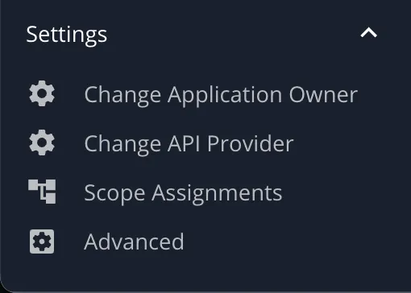
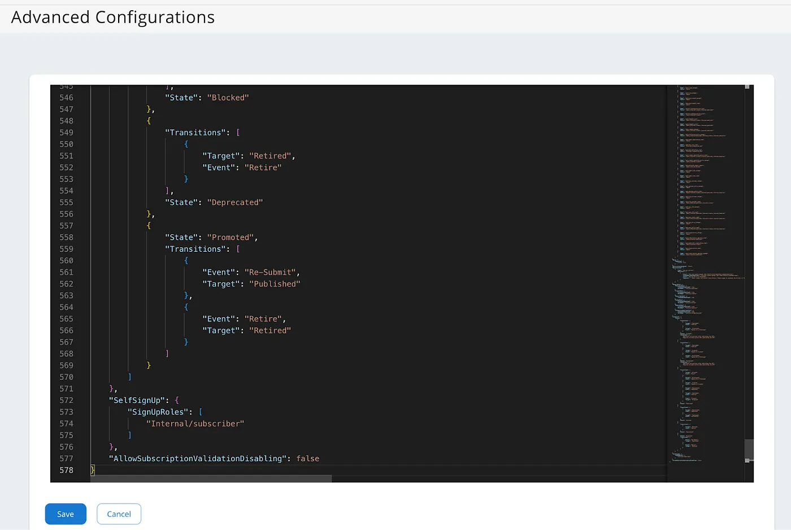
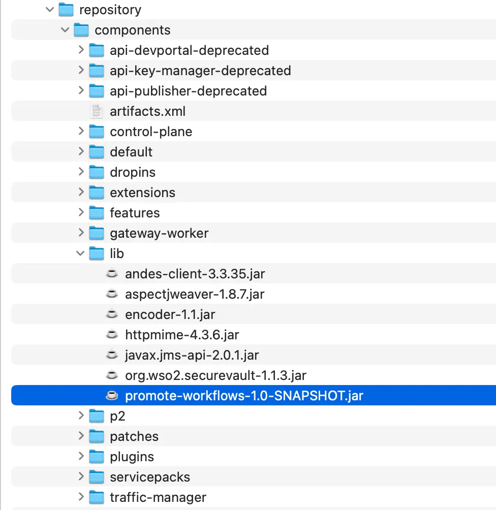
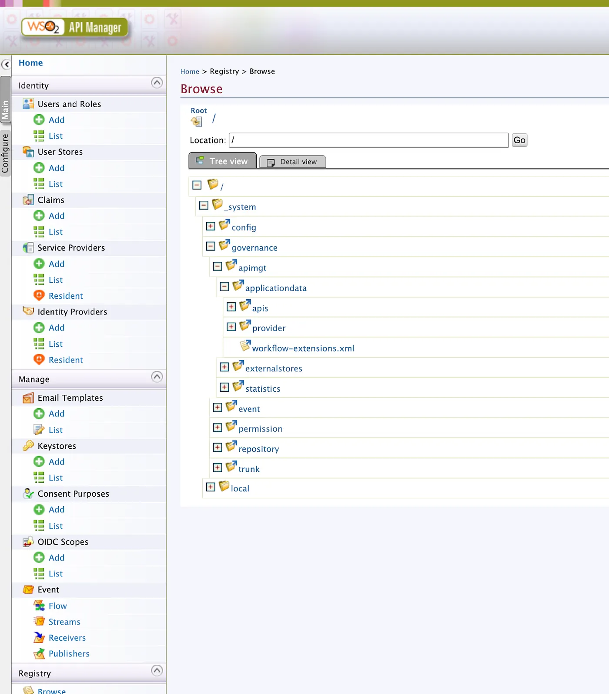
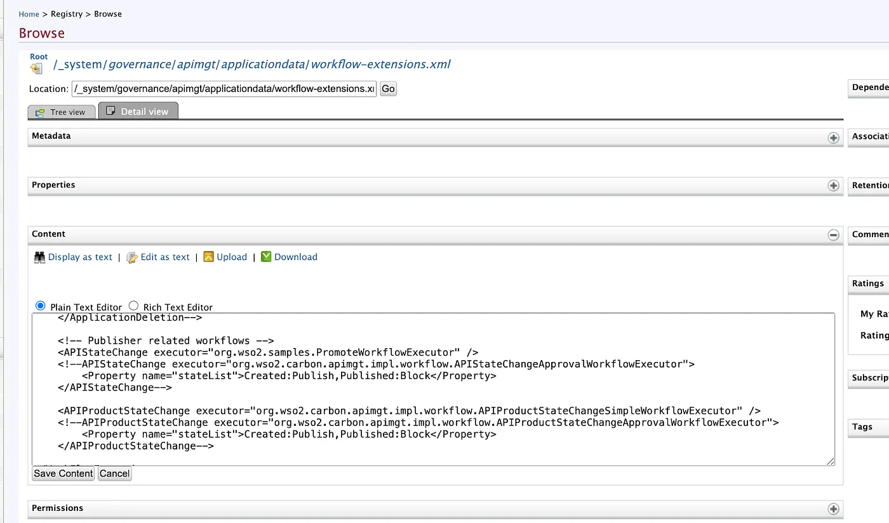
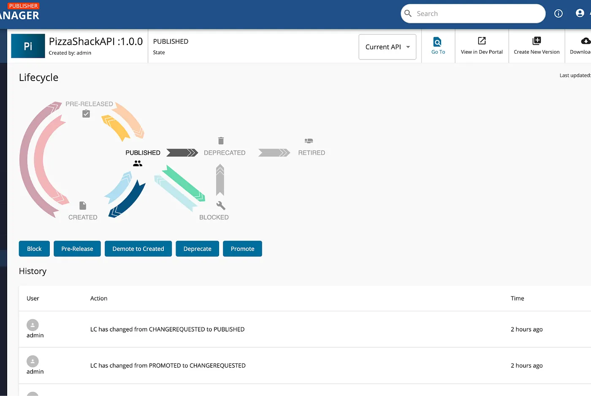
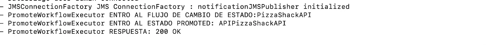
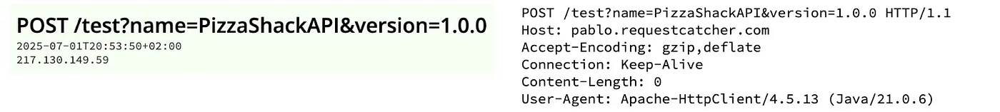

# ¿Cómo agregar un evento ante un cambio de estado de una API en su ciclo de vida?

> Por **Psagarna** · Jul 2, 2025 · 6 min de lectura
> Tags: `WSO2 APIM` · `API` · `API Lifecycle` · `Notifications`

Hoy en día es común enfrentarse al desafío de notificar a sistemas externos cuando ocurre un evento específico. En este caso particular, se trata de enviar una notificación cuando una API cambia de estado dentro de su ciclo de vida.

El caso de uso que abordaré en este artículo consiste en la creación de un nuevo estado, denominado **"Promote"**, y el objetivo será enviar una notificación a un sistema externo cada vez que una API transicione a dicho estado.

Para llevar a cabo este procedimiento, como **requisito** previo, deberán tener instalados los siguientes elementos:

1. OpenJDK Runtime Environment Temurin-21.0.6+7
2. Maven 3.9.10
3. [WSO2 APIM versión 4.5](https://wso2.com/api-manager/)

## Procedimiento

### 1) Crear el estado nuevo "Promote" en el ciclo de vida de la API

Voy a seguir la [documentación](https://apim.docs.wso2.com/en/latest/manage-apis/design/lifecycle-management/customize-api-life-cycle/) de WSO2.

**a)** Entrar en la consola admin de WSO2, en mi caso es <https://localhost:9443/admin> e ir al apartado "Settings" → "Advanced".



**b)** Crear el nodo **"LifeCycle"** en donde vas a tener los estados por defecto del producto (la configuración por defecto no aparece). Para ello podés copiar el código completo del repo [git](https://github.com/psagarna/apim-lifecycle/blob/main/API%20states-original.txt) y pegarlo tal cual está; recordá "Guardarlo".

Esta es solo la parte de "LifeCycle":

```json
"LifeCycle": {
  "States": [
    {
      "Transitions": [
        { "Target": "Published",  "Event": "Publish" },
        { "Target": "Prototyped", "Event": "Deploy as a Prototype" }
      ],
      "State": "Created",
      "CheckItems": [
        "Deprecate old versions after publishing the API",
        "Requires re-subscription when publishing the API"
      ]
    },
    {
      "Transitions": [
        { "Target": "Published",  "Event": "Publish" },
        { "Target": "Created",    "Event": "Demote to Created" },
        { "Target": "Prototyped", "Event": "Deploy as a Prototype" }
      ],
      "State": "Prototyped",
      "CheckItems": [
        "Deprecate old versions after publishing the API",
        "Requires re-subscription when publishing the API"
      ]
    },
    {
      "Transitions": [
        { "Target": "Blocked",    "Event": "Block" },
        { "Target": "Prototyped", "Event": "Deploy as a Prototype" },
        { "Target": "Created",    "Event": "Demote to Created" },
        { "Target": "Deprecated", "Event": "Deprecate" },
        { "Target": "Published",  "Event": "Publish" },
        { "Event": "Promote",     "Target": "Promoted" }
      ],
      "State": "Published"
    },
    {
      "Transitions": [
        { "Target": "Deprecated", "Event": "Deprecate" },
        { "Target": "Published",  "Event": "Re-Publish" }
      ],
      "State": "Blocked"
    },
    {
      "Transitions": [
        { "Target": "Retired", "Event": "Retire" }
      ],
      "State": "Deprecated"
    },
    {
      "State": "Promoted",
      "Transitions": [
        { "Event": "Re-Submit", "Target": "Published" },
        { "Event": "Retire",    "Target": "Retired" }
      ]
    }
  ]
}
```

Así se debería ver después de reemplazarla por completo por la configuración del repo:



*Para impactar los cambios recomiendo reiniciar el API Manager.*

**c)** Después de reiniciar el servidor, van a poder ver el nuevo botón con el nuevo estado "Promote" en el apartado del ciclo de vida de la API.


*Como pueden ver, la imagen del ciclo de vida no ha cambiado; esta imagen también la pueden cambiar para que coincida con el flujo descrito en el archivo de configuración y para que, a fines visuales, quede más entendible. Para no perder el foco del artículo no voy a cambiarla, pero van a poder hacerlo siguiendo los pasos de la [documentación](https://apim.docs.wso2.com/en/latest/manage-apis/design/lifecycle-management/customize-api-life-cycle/).*

### 2) Crear la implementación relacionada con los cambios de estado

Para ello me guié por la [documentación](https://apim.docs.wso2.com/en/latest/reference/customize-product/extending-api-manager/extending-workflows/configuring-http-redirection-for-workflows/) de WSO2.

**a)** Bajarse el código del proyecto Java–Maven del [repo](https://github.com/psagarna/apim-lifecycle/tree/main/promote-workflows), donde van a encontrar el archivo [**PromoteWorkflowExecutor.java**](https://github.com/psagarna/apim-lifecycle/blob/main/promote-workflows/src/main/java/org/wso2/samples/PromoteWorkflowExecutor.java), que extiende de la clase **APIStateChangeSimpleWorkflowExecutor**.

**b)** Voy a sobreescribir el método **`execute()`**, que es el que se invoca al comienzo cada vez que se hace el cambio de estado. Luego se encuentra el método **`complete()`**, que se ejecuta al final del flujo (en el caso de que un estado requiera aprobación por un tercero, por ejemplo, quedaría "On Hold" y, al aprobarse, termina invocando este método).

Dentro del método **`execute()`** está la implementación que invoca un webhook externo llamado <https://pablo.requestcatcher.com> con los datos propios de la API. Para simplificar el caso utilicé el servicio de [requestcatcher.com](http://requestcatcher.com) como webhook, pero podría reemplazarse por la llamada a cualquier servicio externo.

```java
public class PromoteWorkflowExecutor extends APIStateChangeSimpleWorkflowExecutor {

    private static final long serialVersionUID = 1L;
    private static final Log log = LogFactory.getLog(PromoteWorkflowExecutor.class);

    @Override
    public WorkflowResponse execute(WorkflowDTO workflowDTO) throws WorkflowException {

        APIStateWorkflowDTO apiStateWorkFlowDTO = (APIStateWorkflowDTO) workflowDTO;

        // Imprime la acción siguiente del ciclo de vida del API, el botón que ha presionado!
        String nextAction = apiStateWorkFlowDTO.getApiLCAction();
        log.error("PromoteWorkflowExecutor: Next Action: " + nextAction);

        if (nextAction != null && "Promoted".equalsIgnoreCase(nextAction.trim())) {

            URL serviceEndpointURL = new URL("https://pablo.requestcatcher.com/test");
            HttpClient httpClient = APIUtil.getHttpClient(serviceEndpointURL.getPort(), serviceEndpointURL.getProtocol());
            HttpPost httpPost = new HttpPost("https://pablo.requestcatcher.com/test"
                    + "?name=" + apiStateWorkFlowDTO.getApiName()
                    + "&version=" + apiStateWorkFlowDTO.getApiVersion());

            try {
                HttpResponse response = httpClient.execute(httpPost);
                String respuesta = response.getStatusLine().getStatusCode() + " " + response.getStatusLine().getReasonPhrase();
                log.error("RESPUESTA: " + respuesta);

            } catch (ClientProtocolException e) {
                String errorMsg = "Error while creating the http client";
                log.error(errorMsg, e);
                throw new WorkflowException(errorMsg, e);
            } catch (IOException e) {
                String errorMsg = "Error process...";
                log.error(errorMsg, e);
                throw new WorkflowException(errorMsg, e);
            }
        }

        return super.execute(workflowDTO);
    }
}
```

**c)** Compilar el proyecto Java con el comando **`mvn clean install`** para generar el jar. Si tenés algún problema con la instalación, dejo el jar generado en el [repo](https://github.com/psagarna/apim-lifecycle/blob/main/promote-workflows/target/promote-workflows-1.0-SNAPSHOT.jar) por si querés reutilizarlo.

### 3) Instalar y configurar el jar en WSO2 APIM

Seguí la siguiente [documentación](https://apim.docs.wso2.com/en/latest/reference/customize-product/extending-api-manager/extending-workflows/configuring-http-redirection-for-workflows/#deploying-the-custom-workflow-executor) como ayuda.

**a)** Copiar el jar generado en la carpeta **`<APIM_HOME>/repository/components/lib`**. *¡Recomiendo hacerlo con la instancia apagada!*



**b)** Ahora es necesario configurar la llamada a la clase **`org.wso2.samples.PromoteWorkflowExecutor`** que hemos creado, para que cada vez que se cambie el estado de la API sea invocada. Para ello hay que acceder a WSO2 Carbon, en mi caso <https://localhost:9443/carbon>.

Dentro de WSO2 Carbon, ir al apartado **"Registry → Browse"** y seleccionar la ruta **`/_system/governance/apimgt/applicationdata/workflow-extensions.xml`**; por último, seleccionar el archivo **workflow-extensions.xml**.



**c)** Reemplazar la clase executor por la que hemos creado previamente: **`org.wso2.samples.PromoteWorkflowExecutor`**. Para eso hay dos formas: o se edita manualmente, o directamente podés usar "Upload" del archivo [workflow-extensions-modified.xml](https://github.com/psagarna/apim-lifecycle/blob/main/workflow-extensions-modified.xml) que comparto en el repo.

```xml
<WorkFlowExtensions>
    <APIRevisionDeployment executor="org.wso2.carbon.apimgt.impl.workflow.APIRevisionDeploymentSimpleWorkflowExecutor"/>
    <!--APIRevisionDeployment executor="org.wso2.carbon.apimgt.impl.workflow.APIRevisionDeploymentApprovalWorkflowExecutor"/-->
    <ApplicationCreation executor="org.wso2.carbon.apimgt.impl.workflow.ApplicationCreationSimpleWorkflowExecutor"/>
    <!--ApplicationCreation executor="org.wso2.carbon.apimgt.impl.workflow.ApplicationCreationApprovalWorkflowExecutor"/-->
    <ProductionApplicationRegistration executor="org.wso2.carbon.apimgt.impl.workflow.ApplicationRegistrationSimpleWorkflowExecutor"/>
    <!--ProductionApplicationRegistration executor="org.wso2.carbon.apimgt.impl.workflow.ApplicationRegistrationApprovalWorkflowExecutor"/-->
    <SandboxApplicationRegistration executor="org.wso2.carbon.apimgt.impl.workflow.ApplicationRegistrationSimpleWorkflowExecutor"/>
    <!--SandboxApplicationRegistration executor="org.wso2.carbon.apimgt.impl.workflow.ApplicationRegistrationApprovalWorkflowExecutor"/-->
    <SubscriptionCreation executor="org.wso2.carbon.apimgt.impl.workflow.SubscriptionCreationSimpleWorkflowExecutor"/>
    <!--SubscriptionCreation executor="org.wso2.carbon.apimgt.impl.workflow.SubscriptionCreationApprovalWorkflowExecutor"/-->

    <SubscriptionUpdate executor="org.wso2.carbon.apimgt.impl.workflow.SubscriptionUpdateSimpleWorkflowExecutor"/>
    <!--SubscriptionUpdate executor="org.wso2.carbon.apimgt.impl.workflow.SubscriptionUpdateApprovalWorkflowExecutor"/-->
    <!--SubscriptionUpdate executor="org.wso2.carbon.apimgt.impl.workflow.SubscriptionUpdateWSWorkflowExecutor">
         <Property name="serviceEndpoint">http://localhost:9765/services/SubscriptionApprovalWorkFlowProcess/</Property>
         <Property name="username">admin</Property>
         <Property name="password">admin</Property>
         <Property name="callbackURL">https://localhost:8243/services/WorkflowCallbackService</Property>
    </SubscriptionUpdate-->
    <UserSignUp executor="org.wso2.carbon.apimgt.impl.workflow.UserSignUpSimpleWorkflowExecutor"/>
    <!--UserSignUp executor="org.wso2.carbon.apimgt.impl.workflow.UserSignUpApprovalWorkflowExecutor"/-->

    <!--
    ***NOTE:***
        Users of deletion workflows are expected to implement their own deletion workflow executors and services.
        By default API Manager only implements the core functionalities required to support deletion workflows and
        simple deletion workflow executors. Default WS deletion workflow implementations are not available with the
        distribution.
    -->

    <SubscriptionDeletion executor="org.wso2.carbon.apimgt.impl.workflow.SubscriptionDeletionSimpleWorkflowExecutor"/>
    <!--SubscriptionDeletion executor="org.wso2.carbon.apimgt.impl.workflow.SubscriptionDeletionSimpleWorkflowExecutor">
         <Property name="serviceEndpoint">http://localhost:9765/services/SubscriptionApprovalWorkFlowProcess/</Property>
         <Property name="username">admin</Property>
         <Property name="password">admin</Property>
         <Property name="callbackURL">https://localhost:8243/services/WorkflowCallbackService</Property>
    </SubscriptionDeletion -->
    <ApplicationDeletion executor="org.wso2.carbon.apimgt.impl.workflow.ApplicationDeletionSimpleWorkflowExecutor"/>
    <!--ApplicationDeletion executor="org.wso2.carbon.apimgt.impl.workflow.ApplicationDeletionSimpleWorkflowExecutor">
         <Property name="serviceEndpoint">http://localhost:9765/services/ApplicationApprovalWorkFlowProcess/</Property>
         <Property name="username">admin</Property>
         <Property name="password">admin</Property>
         <Property name="callbackURL">https://localhost:8243/services/WorkflowCallbackService</Property>
    </ApplicationDeletion-->

    <!-- Publisher related workflows -->
    <APIStateChange executor="org.wso2.samples.PromoteWorkflowExecutor" />
    <!--APIStateChange executor="org.wso2.carbon.apimgt.impl.workflow.APIStateChangeApprovalWorkflowExecutor">
        <Property name="stateList">Created:Publish,Published:Block</Property>
    </APIStateChange-->

    <APIProductStateChange executor="org.wso2.carbon.apimgt.impl.workflow.APIProductStateChangeSimpleWorkflowExecutor" />
    <!--APIProductStateChange executor="org.wso2.carbon.apimgt.impl.workflow.APIProductStateChangeApprovalWorkflowExecutor">
        <Property name="stateList">Created:Publish,Published:Block</Property>
    </APIProductStateChange-->

</WorkFlowExtensions>
```

Quedaría así después de importarlo:



*Para impactar los cambios recomiendo reiniciar el API Manager.*

### 4) Realizar las pruebas a través del WSO2 Publisher

Desde el portal Publisher de WSO2, en mi caso <https://localhost:9443/publisher/>, acceder al ciclo de vida de la API y, desde ahí, cada vez que se pinche en el botón "Promote" van a poder ver que se invoca el webhook configurado.



**Logs:**



**Consola de Request Catcher:** <https://pablo.requestcatcher.com/>


