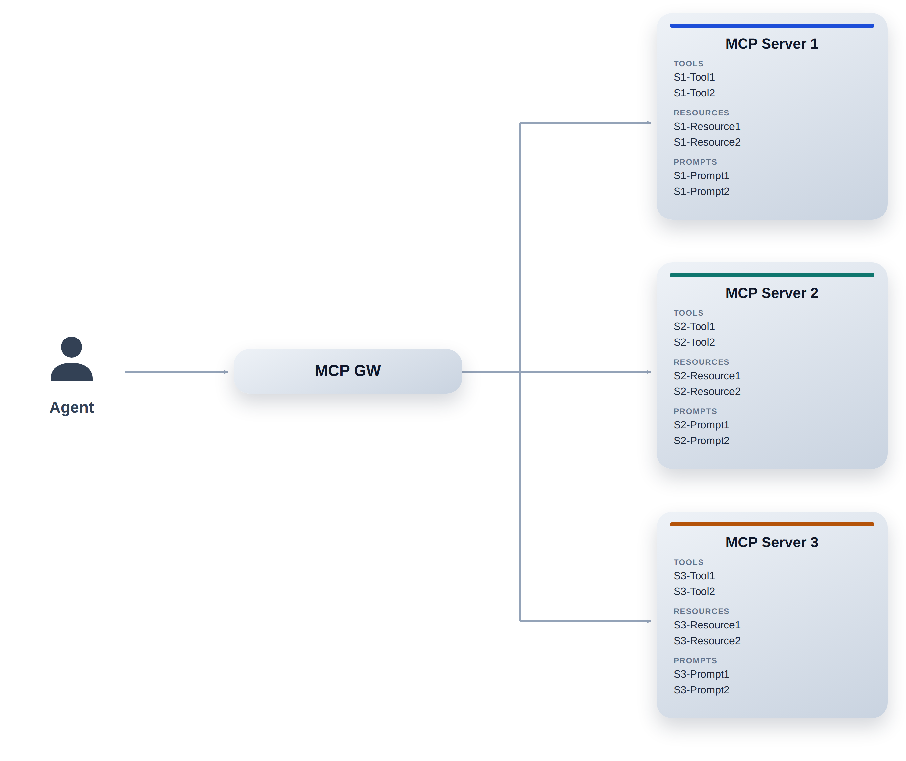
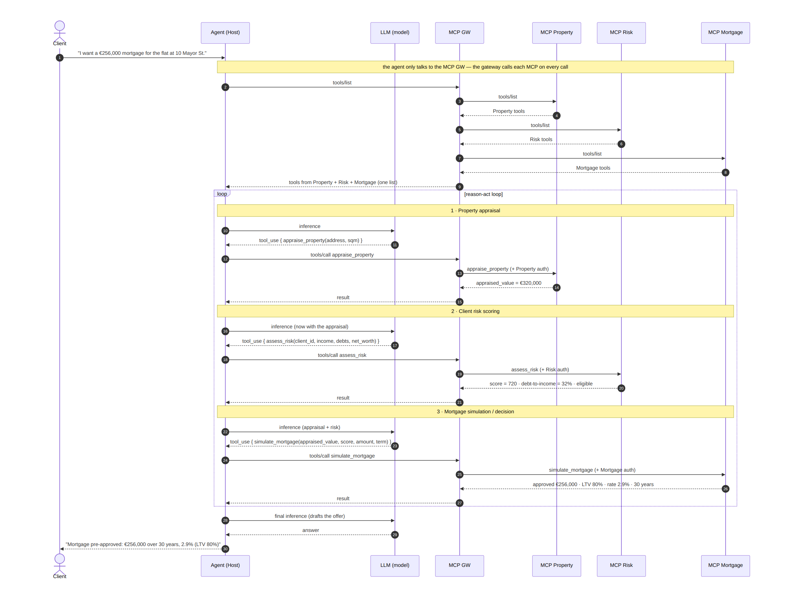
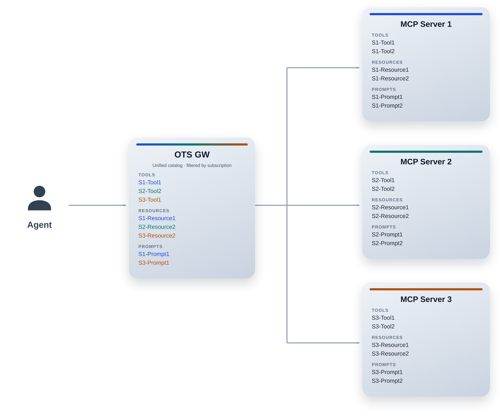
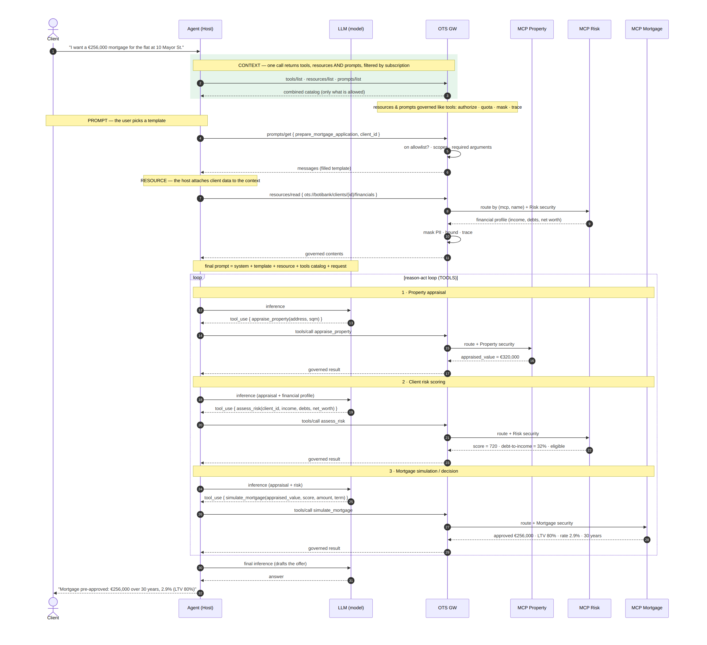
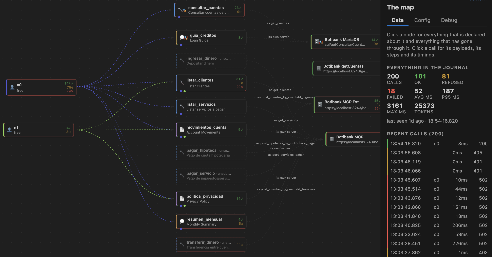

# The OpenTool Specification: A Contract-First Governance Layer for Tools, Resources and Prompts of AI Agents

## Abstract

Agents need access to external tools to perform actions, retrieve information, and interact with enterprise systems. The Model Context Protocol (MCP) facilitates this integration through servers that expose **tools**, which provide capabilities that consuming clients can invoke; **resources**, which provide read-only information that the host can add to the model's context when needed and are typically identified by a fixed URI or a parameterized URI template; and **prompts**, which are predefined, parameterized messages that MCP clients typically expose as commands (e.g., a slash command) to standardize recurring tasks and encapsulate effective prompting practices.

However, as an architecture incorporates multiple MCP servers, each exposing its own tools, resources, and prompts, a new challenge emerges: How can an agent discover the available tools and select the right one without having to manage each server individually? How can it identify the resources and prompts available on each MCP server?

In a distributed architecture, an agent may need to query multiple servers to discover the available tools, resources, and prompts, understand their descriptions, and determine which ones are most relevant to a user's request. As the number of MCP servers grows, this process can introduce considerable complexity.

If discovery is performed sequentially or requires repeated queries to different servers, the system may experience increased latency, additional network traffic, and higher token consumption. Furthermore, providing the model with descriptions and schemas for a large number of tools, irrelevant resources, and unused prompts can put additional pressure on its context window and make it harder to select the most appropriate capabilities.

The challenge extends beyond discovery. Each integration may also require server-specific connection settings, credentials, access policies, and maintenance procedures to be managed by the agent or its runtime, even when an MCP Gateway is available to centralize governance. Managing these elements in a distributed manner increases operational complexity and makes it more difficult to establish a consistent governance and security model.

Therefore, the key challenge is to decouple agents from the complexity of the MCP servers that implement these capabilities and provide a unified mechanism for discovering and accessing them.

## 1. Current approaches and their limitations

Several architectural patterns address this problem, particularly for the tools themselves. These include data retrieval using RAG techniques, hierarchical agents, and/or establishing links with the tools using a specific framework like LangChain.



### Example

A customer requests a mortgage loan from a bank agent: It is clear how the MCP GW has to interact with each MCP server and how the Agent is not exempt from telling the MCP GW which MCP server it has to connect to in order to discover the tools.



### 1.1 Tool Retrieval using RAG

One strategy involves storing tool descriptions and schemas in a searchable repository, such as a vector database. When a user makes a request, the system performs a semantic search to retrieve a narrow set of potentially relevant tools.

Instead of providing the model with the complete catalog, it is presented only with the tools selected for the task.

This approach reduces the volume of information the model receives and facilitates working with extensive catalogs. However, it requires maintaining an up-to-date index of tools, managing their retrieval, and addressing issues such as the relevance of results, metadata synchronization, and the application of access permissions.

Semantic retrieval primarily solves the selection problem within a catalog, but it does not by itself eliminate the need to centralize connections, governance, and access to the MCP servers that implement the tools.

### 1.2 Hierarchical Agents: Supervisor Router

Another alternative is to distribute responsibilities among several agents.

A supervisory agent identifies which functional domain corresponds to the request and decides which MCP server or specialized agent to delegate the task to. Subordinate agents, in turn, work with the tools available in their specific domain.

This architecture allows the problem to be divided and prevents a single agent from having to directly manage all the tools. However, it introduces an additional layer of coordination and requires maintaining information about the capabilities of each server or specialized agent.

Consequently, although hierarchical architecture can improve organization and tool selection, it does not necessarily eliminate the complexity associated with the connections, credentials, and security policies of the various integrations.

### 1.3 Using a framework like LangChain

Agent development frameworks, such as LangChain, offer mechanisms for registering and linking tools to the model, for example, through interfaces such as `bind_tools`, according to the model and integration used.

These abstractions simplify implementation and prevent the developer from having to manually build all the elements necessary to expose the tools to the model.

However, linking tools within a framework does not necessarily equate to having a centralized catalog independent of the infrastructure that implements them. Server management, the resolution of available tools, and the application of access policies still depend on how the architecture was designed.

Therefore, these solutions can be useful for orchestration and integration, but they do not replace a common layer of discovery and governance tools.

## 2. Open Tool Specification (OTS)

Open Tool Specification (OTS) proposes an approach based on the centralized definition of available tools, resources, and prompts, independent of the MCP server that implements them.

It consists of introducing a common layer that allows agents to discover tools, resources, and prompts through a single interface, without needing to know individually all the existing MCP servers.

In this architecture, the OTS Gateway acts as the single point of entry for discovering tools, resources, and prompts. The agent queries this layer and receives, in a single discovery operation, the catalog of tools, resources, and prompts it is allowed to use, according to its identity and applicable security policies.

In this way, the agent no longer depends on an individual exploration process for each MCP server. The resolution of available tools, resources, and prompts is delegated to a centralized layer that abstracts the underlying infrastructure.



### 2.1 How the architecture works

The proposed flow can be described in four steps:

1. **Discovery request.** The agent queries the OTS Gateway to learn about the tools, resources, and prompts available for its execution context, regardless of whether MCP Server implements them behind the scenes.
2. **Catalog resolution.** The gateway identifies the registered tools, resources, and prompts and applies the access policies corresponding to the agent's identity.
3. **Unified response.** The gateway returns the specifications of the authorized tools, resources, and prompts, including the descriptions and schemas necessary for the agent to select them.
4. **Tool invocation.** The agent uses the obtained specification to request the execution of the tool, request the resource and/or prompts through the OTS Gateway, which must resolve its destination and apply the corresponding controls.

This last step is important: centralizing discovery does not necessarily imply centralizing execution as well. The OTS gateway must provide the necessary mechanisms to route invocations to the corresponding MCP servers.

### 2.2 Separation between the agent and the backend implementation

One of the fundamental principles of this proposal is to **decouple the agent from the specific details of each MCP server** registered on the company's infrastructure. For this, the agent needs a unified and aggregated view of the tools, resources, and prompts available across the MCP server suite without needing to know the specific details of each one. From this common view, you can select the capabilities you need based on your role, the scopes assigned and the subscriptions or permissions enabled.

This approach allows managing and governing capabilities with finer granularity regardless of how they are distributed or implemented across the various MCP servers. This allows agents to discover and utilize the appropriate capabilities more efficiently, securely, and with greater control.

Without a common layer of abstraction and governance, the agent or application orchestrating the process may be forced to learn the location of each server, how to connect to it, and how to discover the tools, resources, and prompts it exposes. As new MCP servers are added and the number of available capabilities increases, this information can become scattered across configurations, code, and various security components, increasing complexity and making maintenance and control more difficult.

OTS introduces a single access interface for agents to discover the available capabilities (tools, resources, and prompts) within the company, delegating the resolution of these tools, resources, and prompts, as well as access management to their implementations, to the OTS Gateway. This allows the addition of new MCP servers and their capabilities to be managed from a centralized and governed layer, without requiring modifications to the agent's discovery logic each time the underlying infrastructure changes.

This separation favors a more modular and scalable architecture: the agents focus on interpreting requests and selecting the capabilities they need, while the OTS GW handles logging, discovery, resolution, and access control. The result is a model in which capabilities (tools, resources, and prompts) can evolve independently of the agents that consume them, simplifying their integration and facilitating consistent governance at scale.

#### Example

A customer requests information about a mortgage loan from a bank agent. In this scenario, the agent consults directly with the OTS Gateway to discover the unified catalog of available tools, prompts, and resources, filtered according to its access permissions, scopes and roles.

Based on the capabilities selected by the model to resolve the request, the OTS Gateway identifies the MCP servers that implement the required tools, resources, and prompts and routes invocations only to the authorized and necessary implementations. In this way, the agent can use the capabilities it needs without knowing the details of the underlying MCP servers, while the OTS Gateway centralizes tool resolution and access control.



## 3. Benefits of the Open Tool Specification

### 3.1 Unified discovery and complexity reduction

The agent can obtain the catalog of authorized tools through a single discovery operation, instead of having to query each MCP server individually.

This simplifies the integration flow and can reduce discovery calls, associated latency, and orchestration code complexity.

### 3.2 Optimizing token consumption

By offering a centralized catalog, OTS makes it easier to implement strategies to provide the agent only with the tools they need or are allowed to use.

The actual token savings will depend on how the gateway response is designed. If the entire catalog is returned, context consumption may still be high; if filtering, search, or selective discovery mechanisms are incorporated, the amount of information received by the model can be significantly reduced.

### 3.3 Centralized Governance and Security

A common layer allows you to define a single point of application for tool access policies. Instead of distributing all authorization logic among agents, you can manage which tools are available to each identity or execution context from a shared infrastructure.

The gateway can also serve as an integration point for auditing, access control, and policy management. Centralizing access decisions should be complemented by secure credential management, execution controls, and protection of communications with the MCP servers.

### 3.4 Maintenance simplification

The addition, modification, or removal of tools can be managed through a common catalog. This reduces the need to individually update the discovery logic of each agent and facilitates infrastructure evolution.

It also allows for reducing the duplication of configurations in consumer applications, provided that the server connections and credentials are managed from the corresponding infrastructure layer.

### 3.5 Independence from implementation

The proposal aims for the agent to know the specification of a tool, but not need to know all the details of the server that implements it.

This decoupling makes it easier to incorporate new integrations and change underlying implementations with less impact on consuming agents, as long as the published contracts and interfaces remain stable.

### 3.6 Paradigm shift

Currently, there is a trend toward viewing MCP servers as a direct integration layer with existing APIs, exposing their operations through MCP tools. While this approach facilitates visibility and governance of integrations from a human perspective, it doesn't necessarily represent the most efficient model for agent interaction with business capabilities.

Agent interaction doesn't necessarily have to replicate the structure or consumption model of enterprise APIs. Directly transferring the API paradigm to the agent context can introduce unnecessary complexity in tool discovery, selection, and composition. An MCP tool can encapsulate more granular business operations, abstract multiple API calls, and offer a semantic interface more aligned with the agent's intent. Therefore, MCP tool design shouldn't be limited to replicating existing endpoints, but rather should focus on optimizing the agent's interaction with business capabilities, reducing orchestration complexity and the operational cost of completing a task.

## 4. Design

To realize these benefits, OTS must clearly define several aspects of its architecture:

- **Specification model:** how the tools, their parameters, their results, and their execution requirements are described.
- **Recording and discovery:** how tools are added to, updated, and removed from the central catalog.
- **Authorization:** how is it determined which tools each agent can discover and invoke?
- **Resolution and routing:** how each specification is associated with the server or service that implements the tool.
- **Credential management:** how to store and use credentials without unnecessarily exposing them to agents.
- **Observability and auditing:** how discoveries, access decisions, and invocations are recorded.
- **Availability and performance:** how gateway failures, catalog caching, and change propagation are handled.

These issues are especially relevant because a centralized layer simplifies agent interaction but also becomes a critical infrastructure component. Its design must consider scalability, availability, and security from the outset.

### 4.1 Schema definition

```yaml
ots: "1.0.0"
info:
  title: "BotiBank Core Tools"
  version: "1.2.0"
servers:
  - protocol: streamable-http
    url: "https://localhost:8243/botibankmcp/1.0/mcp"
security:
  - AgentOAuthClientCredentials: []
tools: { }
resources: { }
prompts: { }
components: { }
```

### 4.2 Example

```yaml
ots: "1.0.0"
info:
  title: "BotiBank Core Tools"
  version: "1.2.0"
servers:
  - protocol: streamable-http
    url: "https://localhost:8243/botibankmcp/1.0/mcp"
security:
  - AgentOAuthClientCredentials: []
tools:
  list_customers:
    name: "list_customers"
    # Actual tool name in the target MCP server (WSO2 BotiBankMCP)
    backend:
      tool: "get_clientes"
    summary: "List customers"
    description: "Retrieves the complete list of the bank's customers."
    cache:
      ttlMs: 300000              # 5 min
    inputSchema:
      type: "object"
      properties: {}             # No parameters
      additionalProperties: false # Recommended by MCP for tools without parameters
      example: {}
    outputSchema:
      type: "object"
      additionalProperties: false
      properties:
        clientes:
          type: "array"
          items:
            $ref: "#/components/schemas/Cliente"
      # Example response returned by the mock (OpenAPI format: example)
      example:
        - id: "71992c72-cc1c-4c5a-8b50-9ee4fb6c214d"
          nombre: "Ana"
          apellido: "García"
        - id: "88888888-cc1c-4c5a-8b50-9ee4fb6c214d"
          nombre: "Pablo"
          apellido: "Saga"
        - id: "99999999-cc1c-4c5a-8b50-9ee4fb6c214d"
          nombre: "María"
          apellido: "López"
    server:
      - protocol: streamable-http
        url: "https://localhost:8243/botibankext/1.0/mcp"
        description: "WSO2 API Gateway - SSE connection for BotiBank Agent"

resources:
  privacy_policy:
    title: "Privacy Policy"
    description: "Current legal text regarding data treatment."
    uri: "ots://botibank/politica-privacidad"
    mimeType: "text/markdown"
    # SAME STRUCTURE AS TOOLS
    example: |
      # Privacy Policy v2.1
      BotiBank treats your data with the highest security...
    server:
      - protocol: streamable-http
        url: "https://localhost:8243/botibankext/1.0/mcp"
        description: "Document Center Server"

prompts:
  monthly_summary:
    title: "Monthly Summary"
    description: "Generates an executive summary of monthly spending."
    arguments:
      - name: "cuenta_id"
        description: "The account ID to summarize"
        required: true
    example:
      messages:
        - role: "user"
          content: { type: "text", text: "Act as a financial expert. Analyze account {cuenta_id}..." }
    server:
      - protocol: streamable-http
        url: "https://localhost:8243/botibankmcp/1.0/mcp"
        description: "AI Prompt Studio Server"

components:
  schemas:
    Servicio:
      type: "object"
      properties:
        codigoServicio: { type: "string" }
        nombre: { type: "string" }
        monto: { type: "number" }
        vencimiento: { type: "string" }
    Cliente:
      type: "object"
      properties:
        id: { type: "string" }
        nombre: { type: "string" }
        apellido: { type: "string" }
        email: { type: "string" }
    Cuenta:
      type: "object"
      properties:
        cuentaId: { type: "string" }
        clienteId: { type: "string" }
        saldo: { type: "number" }
        tipo: { type: "string", enum: [ "Corriente", "Ahorro", "Inversión", "Sueldo" ] }
  securitySchemes:
    AgentOAuthClientCredentials:
      type: oauth2
      description: "Token de acceso emitido por WSO2 para BotiBank Agent (M2M)"
      flows:
        clientCredentials:
          tokenUrl: "https://localhost:8243/oauth2/token"
          scopes:
            "mcp:invoke": "Llamada básica a herramientas"
    UserDelegationOAuth:
      type: oauth2
      description: "Token del usuario final para operaciones que mueven fondos"
      flows:
        authorizationCode:
          authorizationUrl: "https://localhost:8243/oauth2/authorize"
          tokenUrl: "https://localhost:8243/oauth2/token"
          scopes:
            "bank:transfer:execute": "Aprobación de movimientos de fondos"
            "cuentas:read": "Lectura de cuentas y de sus movimientos"
            "clientes:read": "Lectura de la cartera de clientes"
```

## 5. OTS Gateway

The OTS Gateway acts like any other gateway, receiving a request and routing it to the appropriate backend server. It exposes a single point of access where agents can discover which tools, prompts, and resources are available to them based on their access role, scope, or active subscription.

### 5.1 Server Prototype — easy to configure

```jsonc
{
  "otsgateway": { "server_port": "7082", "watch_files": true },
  "dashboard":  { "port": "7084", "access_key": "env:OTS_DASHBOARD_KEY" },
  "console":    { "port": "7085", "access_key": "env:OTS_CONSOLE_KEY" },
  "mock_server":{ "enabled": true, "server_port": "7086" },
  "telemetry":  { "file": "logs/transactions.jsonl", "max_history": 500 },
  "plans": {
    "free": { "rate_per_second": 2, "burst": 5,
              "quota_hourly": 60, "quota_daily": 500,
              "tokens_hourly": 50000, "max_tokens_per_call": 12000 }
  },
  "mcps": [{
    "name": "botibank",
    "context_path": "/botibank",
    "ots_file": "boti-bank-ots.yaml",
    "output": { "enforce": "warn" },
    "backend_server": [
      { "name": "Core",
        "url": "https://localhost:8243/botibankmcp/1.0/mcp",
        "security": { "type": "OAuth2",
                      "token_url": "https://localhost:9443/oauth2/token",
                      "consumer_key": "env:BOTIBANK_KEY",
                      "consumer_secret": "env:BOTIBANK_SECRET" }}
    ]
  }],
  "subscriptions": [{
    "consumer_name": "c0",
    "security": [{
      "mcps": [{ "botibank": {
        "tools": [ { "transferir_dinero": ["bank:transfer:execute"] }, "consultar_cuentas" ],
        "resources": [ { "movimientos_cuenta": ["cuentas:read"] }, "politica_privacidad" ],
        "prompts": [ { "revisar_clientes": ["clientes:read"] }, "resumen_mensual" ]
      } }],
      "auth_method": [{ "api_key": "env:C0_API_KEY" }],
      "key_plan": "free"
    }]
  }]
}
```

### 5.2 VS Code plugin — Visual Designer for OTS



*Download from the Microsoft VS Code Marketplace.*

## 6. Conclusion

As artificial intelligence architectures incorporate more MCP servers and an increasing number of tools, resources, and prompts, the discovery, access, and governance of these capabilities and resources become relevant challenges.

Existing approaches, such as tool retrieval using RAGs, hierarchical agents, and framework tool linking mechanisms, address different parts of the problem. However, they don't necessarily provide a common solution for centralizing the entire catalog (tools, resources, and prompts), abstracting implementations, and managing access from a single point of access without having to manage external configurations and security, among other things.

**Open Tool Specification** proposes an architecture in which agents consult a common gateway to obtain the specifications of the tools, resources, and prompts they are authorized to use, regardless of the MCP server that implements them.

The proposal aims to reduce integration complexity, avoid the individual exploration of each server, and facilitate a coherent governance and security model. Its main value lies in separating the discovery and consumption of tools, resources, and prompts from the specific details of how these are implemented.

**Ultimately, OTS aims to provide a common layer between AI agents and the ecosystem of tools, resources, and prompts, promoting simpler, more governable, and scalable discovery and access as the architecture grows.**
